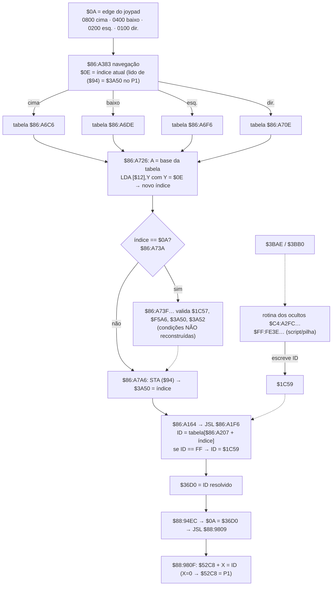

# Fluxo da seleção de personagens (reconstruído)

Baseado em código lido da ROM (ver `docs/EVIDENCIAS.md`). Setas tracejadas = **NÃO VERIFICADO**.
Endereços CPU em notação `$banco:endereço`; `$7E:` omitido nas variáveis WRAM.



## Pseudocódigo fiel ao observado
```c
// $86:A1F6  (confirmado por bytes)
uint16_t resolve(uint16_t idx){ uint8_t id = rom[0x86A207+idx]; return id==0xFF ? wram16(0x1C59) : id; }

// $86:A383..A3E5 (confirmado por bytes); a parte do índice 0x0A em $86:A73A+ NÃO está reconstruída
uint16_t next_index(uint16_t cur, uint16_t pad){
  if (pad & 0x0800) return up[cur];
  if (pad & 0x0400) return down[cur];
  if (pad & 0x0200) return left[cur];
  if (pad & 0x0100) return right[cur];
  return cur;
}
```
Observação: o fluxo real chama `$86:A661` (com `X` = 0, 7, 14, 21) antes de cada tabela e só segue se o Carry volta setado (`BCC` pula a direção). A função de `$86:A661` ainda não foi analisada.

## Pontos de entrada da alternância dos ocultos (estáticos)
| Entrada | Observação |
|---|---|
| `$C4:A2FC` | zera `$1C57` e `$1C59` e prepara `$EB5C` |
| `$C4:A328` | sai se `$3BAE`=`$3BB0`=0; senão espera `$36C6` e decide Shao Kahn (`$3BAE`) ou Motaro (`$3BB0`) |
| `$FF:FE3E`, `FE64`, `FE8A` | escrevem Sheeva, Human Smoke e Idels; chegam por fluxo ainda não resolvido |
| `$88:C7B6` | chamado em todos os blocos (`PEA $84A3 / PEA $8D00 / PHA / JSL $88C7B6`); candidato ao redirecionamento de retorno por pilha |
